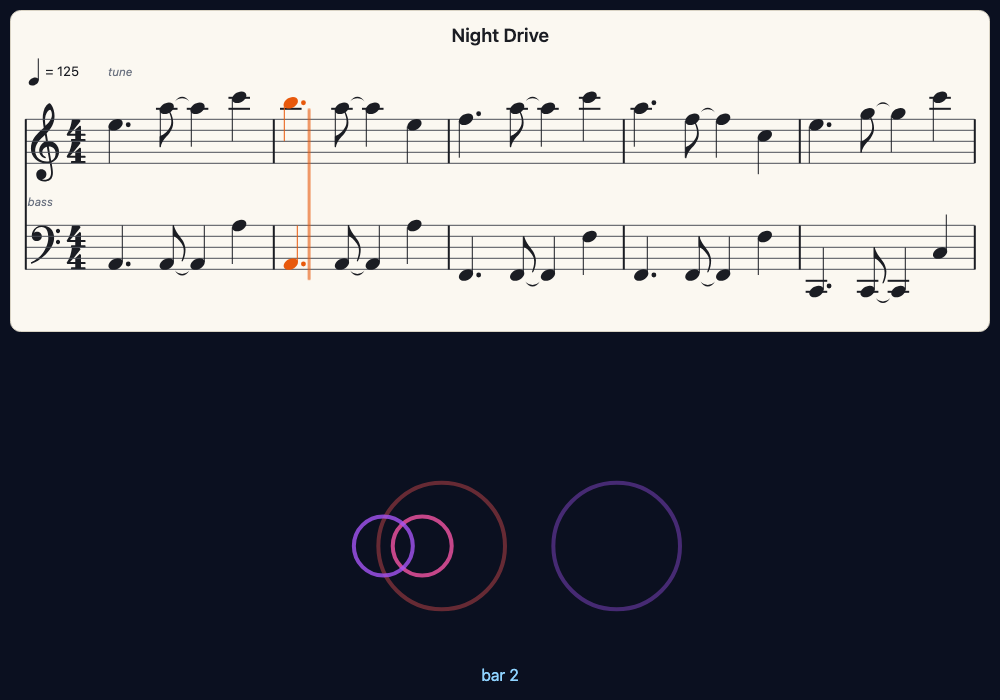
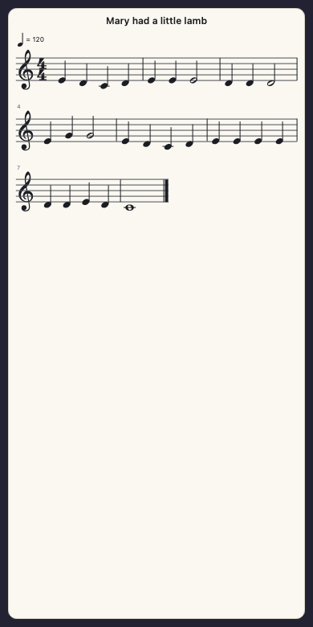
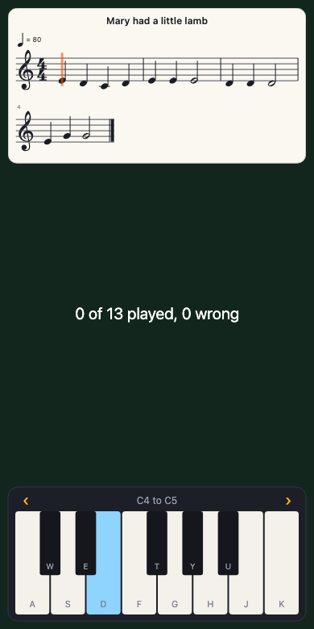
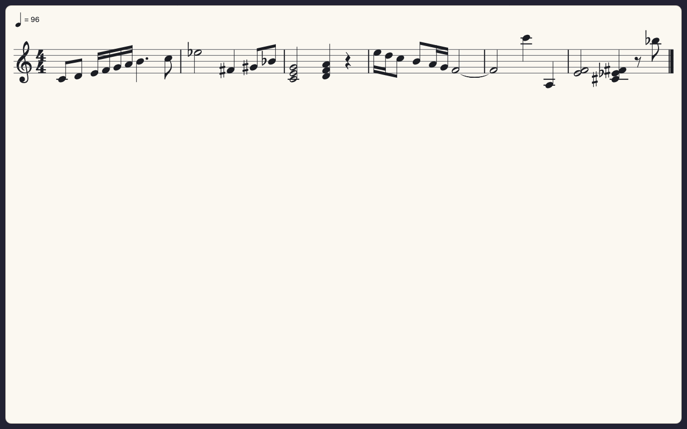

# staves.js

[](LICENSE)



staves.js writes music out as notes on a staff, in plain JavaScript, and lights the notes as they play. It is for any age and any level: you give it a tune in one line and sheet music appears; you play the tune and each note lights as it sounds; you can play along on a keyboard and it tells you how you did. It draws clefs, keys, time signatures, notes and rests of every usual length, dots, ties, beams, chords, ledger lines, bar lines and bar numbers, on as many lines as your screen needs. It is a sibling of [pictures.js](https://github.com/johnwylie70/pictures.js), [synths.js](https://github.com/johnwylie70/synths.js) and [dials.js](https://github.com/johnwylie70/dials.js), designed for projects made in [Circuitry Studio](https://www.circuitry.dev), and runs anywhere a browser does.

Prefer Python? [staves](../staves-py) is the same library for [Pyctures](https://github.com/johnwylie70/pyctures).

## Start with four small scenes

Each one is a whole program for a pictures.js scene. [How to run one](#run-it) is just below.

**1. A tune, written out.**

```js
const { showNotes } = await use("staves.js")

showNotes("E4 D4 C4 D4 E4 E4 E4:2", "quarter", { title: "Mary had a little lamb" })

function draw() {
  background("midnightblue")
}
```



The notes are written the way synths.js's `playNotes` takes them: a note is a letter and a number (`"C4"` is middle C, `"F#3"`, `"Bb5"`), `-` is a rest, `:2` makes a note last two steps, and `"quarter"` says how long a step is. The key, the clef and the bars are worked out for you. Tap a note to hear it.

**2. Play it, and watch it go.**

```js
const { showNotes, useSound } = await use("staves.js")
useSound({ makeSynth, playNote, soundTime })     // the sound the page plays through, and keeps time by

const page = showNotes("C4 C4 G4 G4 A4 A4 G4:2 F4 F4 E4 E4 D4 D4 C4:2", "quarter", { tempo: 100 })
page.onNote = (note) => console.log("now playing", note.name)

function onMouseDown() { page.play() }

function draw() {
  background("midnightblue")
  text("Click here to play", width / 2, height - 30, "white", 18, "centre")
}
```

`page.play()` plays the music and follows it: the notes that are sounding turn orange, a line moves through the bar, and the page turns when the music reaches the next line. `page.onNote` is called as each note begins, so your scene can do something on every note. `page.stop()` stops it.

**3. Follow a song.**

```js
const { showNotes, useSound } = await use("staves.js")
useSound({ playNote, soundTime })

const written = await loadJSON("songs/night_drive.json")
const song = playSong("songs/night_drive.json")
showNotes(written, { channels: [3, 1], follow: song })      // the tune and the bass, a staff each

function draw() {
  background("#0b1020")
}
```

A tracker song (our own JSON kind, or a MOD or XM file the sound library has packed) is turned into written music: you choose which channels to show. As the song plays, the page follows it. Tap a bar and the song jumps there. That is the picture at the top of this page.

**4. Play along.**

```js
const { showNotes } = await use("staves.js")

const lead = makeSynth("keys")
const page = showNotes("E4 D4 C4 D4 E4 E4 E4:2", "quarter")
page.playAlong({ mode: "wait", synth: lead })
keyboard(page, { octave: 4, octaves: 1 })        // a dials.js keyboard plays the page

function draw() {
  background("#12261e")
  text(`${page.result.right} right, ${page.result.wrong} wrong`, width / 2, height / 2, "white", 20, "centre")
}
```



The line waits at each note until you play it. The key to press is lit. A right note turns green; a wrong one shows in red for a moment where you played it. `"time"` in place of `"wait"` keeps going at the tempo whether you are ready or not.

## Run it

Put `staves.js` beside your scene and run the scene with pictures.js:

```
npx pictures run twinkle.js
```

The scenes in [examples/](examples) are ready to run: [twinkle.js](examples/twinkle.js) (a tune written as code), [song.js](examples/song.js) (a song with two staves following) and [play_along.js](examples/play_along.js) (a trainer with a keyboard).

On a page of your own, with no pictures.js, it fills any element:

```html
<div id="music" style="width: 600px; height: 300px"></div>
<script type="module">
  import { staves } from "./staves.js"
  const { showNotes } = staves(document.getElementById("music"))
  showNotes("C4 E4 G4 C5:4", "quarter", { at: "fill" })
</script>
```

It needs no sound to draw music. Nothing else is loaded: staves.js is one file, and a page that does not use it never fetches it.

## What you can show

| You give | It is |
|---|---|
| `showNotes("C4 E4 G4 - C5:2", "quarter")` | a tune as text: notes, `-` for a rest, `:2` for two steps, `:q` `:h` `:e` `:s` `:w` for a length by name, `C4+E4+G4` or `Cm7` for a chord. The second thing is how long a step is (`"eighth"` if you leave it out) |
| `showNotes(["C4", null, ["C4", "E4"]], "quarter")` | the same as a list: `null` is a rest, a list inside is a chord |
| `showNotes(sheet)` | a sheet you write a note at a time (below) |
| `showNotes(song, { channels: [0, 1] })` | a tracker song: the JSON as an object or as text, or the bytes `await packSong(bytes)` makes of a MOD or XM |
| `showNotes("songs/tune.json")` | the name of a song file, which is fetched |
| `showNotes([{ note: "C4", start: 0, length: 1 }, { notes: ["E4", "G4"], start: 1, length: 2 }])` | plain data, in beats: anything can make this |



**A sheet** is for writing music as code, with loops and all:

```js
const sheet = makeSheet({ key: "G", time: "3/4", tempo: 132, title: "Waltz" })
sheet.add("D4", "quarter")
sheet.add(["B4", "D5"], "half")          // a chord
sheet.rest("quarter")
for (const name of ["G4", "A4", "B4"]) sheet.add(name, "eighth")
showNotes(sheet)
```

A length is `"whole"`, `"half"`, `"quarter"`, `"eighth"`, `"sixteenth"` or `"thirtysecond"`, with a dot for half as long again (`"quarter."`), or a number of beats. A sheet that is added to later is drawn again by itself.

## Options

`showNotes(music, { ... })`, or after the step: `showNotes("C4 D4", "quarter", { ... })`.

| Option | |
|---|---|
| `key` | `"C"`, `"G"`, `"Bb"`, `"Am"`, or sharps as a number (`2`) and flats as a negative one (`-3`). Left out: the key with the fewest sharps, flats and naturals to write |
| `time` | `"4/4"` unless you say: `"3/4"`, `"6/8"`, `"2/2"` |
| `clef` | `"treble"`, `"bass"`, `"grand"` (both, joined by a brace: notes from middle C up on the top staff) or `"percussion"`. Left out: whichever the notes sit best in |
| `tempo` | beats a minute, for the mark over the first line and for `page.play()` |
| `title` | written over the music |
| `at` | `"top"` (where it goes unless you say), `"bottom"`, `"middle"`, `"fill"` (the whole picture), or `{ x, y, width, height }`. `x`, `y`, `width` and `height` may also be given by themselves |
| `zoom` | 1 unless you say: 1.5 is half as big again |
| `paper` | `"light"` (cream paper, dark ink), `"dark"`, or `"clear"` (no paper: white ink straight on your scene) |
| `colours` | any of `{ paper, ink, line, now, right, wrong, cursor }`: `now` is the colour of a note that is sounding |
| `scroll` | `"down"`: lines of music one under another, and the page turns. `"across"`: one long line that slides past |
| `lines` | `false` hides the staff lines |
| `barNumbers` | `false` hides the small number over each line |
| `follow` | a song (or a function that gives beats) to follow from the start |
| `hear` | `false`: a tapped note is not played |
| `seek` | `false`: a tapped bar does not move the music there |
| `line` | `false` hides the moving line |

For a song there are also `channels` (which to show, counted from 0, in the order you want the staves), `instruments` (only these, by number or name), `drums` (which instruments are drums, by number or name; left out, an instrument called kick, snare, hat and the like is one), `grand: true` (the tuned channels together on a grand staff) and `rowsPerBeat`.

Every name has its Python spelling too (`show_notes`, `on_note`, `bar_numbers`).

## The page

`showNotes` gives back the page of music.

| | |
|---|---|
| `page.play()` | play it and follow it. `page.play({ from: 8 })` starts eight beats in; `{ tempo: 90 }`, `{ repeat: true }` |
| `page.stop()` | stop, and put everything back to plain ink |
| `page.playing` | is it playing? |
| `page.follow(song)` | follow something else that plays: a song from `playSong`, or a function that gives how many beats have gone by (`page.follow(beat)` follows the sound library's own beat) |
| `page.beat`, `page.bar` | where the music has got to. `page.beat = 12` puts the line there |
| `page.sounding` | the notes sounding now, as numbers |
| `page.onNote = (note) => { }` | a note has just begun: `{ note, notes, name, start, length, staff, bar }` |
| `page.onBar = (bar) => { }` | a bar has just begun |
| `page.onTap = (what) => { }` | a note was tapped (`what.name`), or a bar (`what.bar`) |
| `page.onDone = () => { }` | the music the page was playing has ended |
| `page.seek(5)` | go to bar 5 |
| `page.show(music)` | show other music in its place |
| `page.zoom = 1.5`, `page.place({ at: "bottom" })` | change its size and place |
| `page.x`, `.y`, `.width`, `.height` | where it is in the scene, for drawing around it |
| `page.remove()` | take it away |

Drag the music with a finger, or turn the mouse wheel, to look ahead; it goes back to following a moment later.

### The sound it plays through

staves.js names no sound library. A sound is anything with some of `soundTime()`, `playNote(note, seconds)`, `makeSynth(name)` and `playNotes(text, step, { at })`: `useSound(sound)` hands one over, and `{ sound }` gives one page its own. In a pictures.js scene those are the scene's own sound functions: `useSound({ makeSynth, playNote, soundTime })`. On a page that imports synths.js: `import * as synths from "./synths.js"; useSound(synths)`.

With a sound, `page.play()` is heard and a tapped note sounds. `{ voice: "bell" }` chooses the ready-made synth it plays on, and `{ synth: lead }` gives it a synth of yours. With no sound at all, `page.play()` moves the line in silence, which is still a metronome for the eyes.

**Time is never kept by staves.js.** Where the music has got to is read every frame from what is followed: a song's `position`, or the sound library's clock. So the notes that light are the notes you hear, however busy your scene is.

## Playing along

```js
page.playAlong("wait")                       // or { mode: "wait", synth: lead, staff: 0, hint: true, anyOctave: false }
page.playAlong({ mode: "time", tempo: 60 })  // keeps time, after one bar counted in ({ countIn: 0 } for none)
```

Notes reach the page through `page.noteOn(note)` and `page.noteOff(note)`, from anywhere:

```js
keyboard(page)                                            // dials.js: on-screen keys, and the computer's
function onMidiNote(note, velocity) {                     // synths.js: a real keyboard
  if (velocity > 0) page.noteOn(note); else page.noteOff(note)
}
```

A chord is right when all its notes have been played, in any order. `page.result` is `{ right, wrong, missed, total, percent, timing, done }` as it goes: `timing` is how far from the beat the right notes were, in seconds, when the page keeps time. `page.onRight`, `page.onWrong` and `page.onDone = (result) => { }` are called as they happen. `{ synth: lead }` makes the played notes heard.

## How a tracker song becomes written music

A tracker's grid is rows; written music is beats and bars. This is what staves.js does, and where it guesses.

- **A row is a fixed written length.** Four rows are a beat (so a row is a sixteenth note) at a song speed of 6, eight at 3, two at 12. `rowsPerBeat` says otherwise. The tempo written is the tempo that results.
- **A note lasts** until the next note on its channel, a note-off, a volume of nothing, or the end of its sample if the sample does not loop, and never more than two bars. A note let go a row before the beat is written to the beat, as a player would write it.
- **A bar** is a time signature's worth of rows: 4/4 unless you say `time`.
- **Lengths that are not one note** are written as notes tied together, split so that every beat (and the middle of a 4/4 bar) can be seen. Short notes are beamed a beat at a time.
- **The key** is the one that leaves the fewest sharps, flats and naturals to write; `key` says otherwise. **The clef** of each channel is the one its notes sit best in, written an octave away (with a small 8) if they are very high or low.
- **A chord** on a note (the song format's `chord`, which is heard as a fast arpeggio) is written as that chord with a wavy line beside it, not as dozens of tiny notes.
- **Drums** are instruments called kick, snare, hat, tom, crash and the like, or the ones you name in `drums`. A channel that is mostly drums gets a percussion staff, each drum in its own place, with crosses for cymbals.
- **Not written in this version:** slides, vibrato and other effects that bend a note; pattern loops; triplets and other lengths that are not halves of halves (they are written to the nearest thirty-second); two rhythms at once on one staff (a staff has one rhythm, so a grand staff made of several channels takes the notes that begin together as a chord and ends each where the next begins).

The parts that do this need no screen and are there to use: `write(readMusic("C4 D4", "quarter"))` gives the written music as plain data, and `layout(score, { width })` where everything goes.

## How it is made

**It draws the music itself, on a canvas of its own**, laid over the scene's canvas or filling an element. The music is laid out once for the width it has; while it follows, only the bars whose notes changed colour are drawn again, and the line that moves is an element of its own that the browser slides without drawing anything. So it costs a scene nothing it would notice, on an iPad as on a desktop.

**Why not an existing engraving library?** They were looked at on 13 October 2026, on npm and in their repositories:

| | Licence | Size of the script (gzipped) | |
|---|---|---|---|
| VexFlow 5.0.0 | MIT | 1128 KB (692 KB) with its fonts; 337 KB (91 KB) without | a fine engraver, but layout, line breaking and following are left to the caller |
| abcjs 6.7.1 | MIT | 512 KB (148 KB) | takes ABC text |
| OpenSheetMusicDisplay 2.2.1 | BSD-3-Clause | 1420 KB (360 KB) | takes MusicXML; built on VexFlow |
| alphaTab 1.8.4 | MPL-2.0 | 1121 KB (279 KB) | its files would have to stay under their own licence |
| Verovio 6.3.0 | LGPL-3.0-or-later | 7311 KB (2338 KB) | not a licence this library can carry |
| **staves.js** | **MIT** | **120 KB (41 KB)** | the whole of it, symbols included |

A full engraver knows lyrics, tuplets of every kind and beams across staves, none of which a first version here needs; what is needed here (tracker rows to rhythm, colour a note the moment it sounds, wait for a learner, the same from Python) none of them has. So this is a small renderer made for the job.

**The symbols** (clefs, note heads, flags, rests, sharps and flats, the digits, the brace) are outlines from [Leland](https://github.com/MuseScoreFonts/Leland), MuseScore's music font, which is under the SIL Open Font Licence 1.1. Thirty-four of its glyphs are kept in staves.js as paths, 13 KB of the file, so no font is loaded and nothing waits for one. The licence lets a font be changed and put inside other software, and asks that what is taken stays under it and does not use the font's name: so those outlines remain under the OFL ([LICENSE-GLYPHS](LICENSE-GLYPHS)) while everything else is MIT. [scripts/make-glyphs.py](scripts/make-glyphs.py) takes them from the font file. (Bravura, the other candidate, is 889 KB as a font file and 323 KB as WOFF2; Leland's whole font is 89 KB.)

## Tests

```
PLAYWRIGHT=/path/to/node_modules/playwright node scripts/test-staves.mjs
```

In node: reading tunes, note lengths and ties, beams, keys, clefs, tracker rows to rhythm (on songs made in the test and on Night Drive), and the layout's geometry at four widths (nothing overlaps, every note on its line, every stem the right way). In Chromium and WebKit, silently: there is ink where the layout puts each note at phone, split-view, tablet and desktop sizes; with the real synths.js playing, each note lights within a tenth of a second of the synth sounding it, and the lit bass note of a song is the one the song's own rows give, to within a row; a learner's notes are marked and counted; a dials.js keyboard plays the page; a MOD goes through `packSong`; every example runs as a pictures.js scene. `--node` runs the first part alone, and `--shots` saves pictures.

## Licence

MIT, © John Wylie. The music symbols' outlines are from the Leland font, © MuseScore BVBA, under the SIL Open Font Licence 1.1: see [LICENSE-GLYPHS](LICENSE-GLYPHS).
